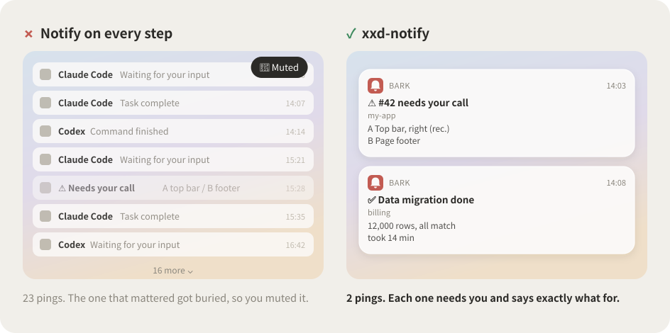

<div align="center">

# xxd-notify

**Your phone buzzes only when the AI actually needs you.**

A Bark notification skill for Claude Code and Codex: it knows when to interrupt you, says what it needs, and gets through when the network doesn't.

<a href="README.md">简体中文</a> · <strong>English</strong>


</div>

<p align="center">
  
</p>

<p align="center">
  <a href="#-install">Install</a> ·
  <a href="#-when-it-rings">When it rings</a> ·
  <a href="#-what-a-good-notification-looks-like">Good notifications</a> ·
  <a href="#-usage">Usage</a> ·
  <a href="#-nothing-gets-lost">Offline</a> ·
  <a href="#-configure">Configure</a> ·
  <a href="#-faq">FAQ</a>
</p>

## 😵 Why

You hand Claude a ninety-minute refactor, then flip back to the terminal every ten minutes and get nothing else done. Finally you go to lunch — and come back to find it stopped at minute three to ask "Export button: A or B?" It has been waiting for you for forty minutes.

So you wire up notifications. Now it pings on every step: waiting for input, task complete, command finished… 23 pings in one afternoon, so you mute it. And the one ping that actually needed you gets muted along with the rest.

<p align="center">
  
</p>

| | Babysitting | Ping on every stop (Stop hook etc.) | xxd-notify |
|---|---|---|---|
| When you hear about it | when you check | whenever the agent stops, for any reason | only for a decision, a failure, or done |
| What it says | — | "Waiting for your input" | what to decide, what it recommends, where to look |
| Focus mode | — | all the same | decisions break through; the rest is regular or silent |
| Same question | — | pings again on every stop | asks once |
| Network drops | — | message is gone | retries, shows on your Mac, resends later |
| Footprint | — | — | one Python file, zero dependencies |

## ⚡ Install

**First, get [Bark](https://github.com/Finb/Bark) on your iPhone** (App Store: "Bark") and copy your push URL from the app.

### Let your agent install it (recommended)

Send this to Claude Code or Codex:

```text
Install xxd-notify: https://github.com/nevertoday/xxd-notify
Clone it into ~/.claude/skills/xxd-notify (and ~/.codex/skills/ too if I use Codex).
Then tell me which setup command to run in my terminal. I'll paste the Bark URL myself — don't ask me to send it in chat.
```

### One command

```bash
npx skills add https://github.com/nevertoday/xxd-notify --skill xxd-notify
# or: git clone https://github.com/nevertoday/xxd-notify ~/.claude/skills/xxd-notify
```

Then paste your Bark URL:

```bash
python3 ~/.claude/skills/xxd-notify/scripts/xxd_notify.py setup
```

Input is hidden and never lands in your shell history. In Claude Code you can type `! python3 ~/.claude/skills/xxd-notify/scripts/xxd_notify.py setup`. A "🧪 Bark 连接正常" test notification means you're done.

> [!TIP]
> Python 3.8+ only, nothing to install. macOS and most Linux distros already have it.

## 🔔 When it rings

<p align="center">
  
</p>

- **Needs your call** — pick a plan, spend money, email real users, delete data, log in or renew. Sent as Bark `timeSensitive`, so it shows even in Focus mode: without you, nothing moves.
- **Failed or stopped** — it can't fix it alone, or quota ran out. Also breaks through Focus.
- **Done / milestones you asked for** — regular alerts. Milestones only on request.
- **Everything else** — silence.

And **it only notifies when you ask it to**. Ordinary chats and tasks never trigger a push.

## 📱 What a good notification looks like

| Typical | xxd-notify |
|---|---|
| Task complete | **✅ Data migration finished**<br>12,000 records, all verified<br>took 14 min |
| Action required | **⚠️ #42 needs your call**<br>A Export button in the top bar (recommended)<br>B Put it in the footer<br>Reply A/B in the terminal · *tap to open the proposal* |
| Error | **⏹️ Quota ran out, job paused**<br>stopped at file 37/120<br>progress saved — say "continue" when quota is back |

- **The subtitle names the project** automatically, so with five sessions open you know which one to answer.
- **The first line is the point** — readable from the lock screen.
- **It asks once.** The same question won't ping you every ten minutes.

## 🧭 Usage

### Just tell your agent

No commands to learn. Say *when* you want to hear from it:

- "Run the whole test suite and Bark me when it's done — failures too."
- "Loop through the open issues. Whenever you need me to confirm something (choose a design, spend money, email real users, delete data), Bark me first and say what to confirm and where to look."
- "Process these 500 images, ping me at every 20%, and right away if something breaks."
- "Keep an eye on that background batch — tell me if it stalls or the disk gets low, and when it finishes."
- "I don't think that Bark arrived — check whether it went out."

A standing rule like "Bark me when you need my call" holds for the whole session or loop. The skill itself is in [SKILL.md](SKILL.md).

### Without an agent

```bash
alias notify="python3 ~/.claude/skills/xxd-notify/scripts/xxd_notify.py"
```

| Command | What it does |
|---|---|
| `notify run --title "tests" --tail 3 -- npm test` | wraps any long command; ✅ or ❌ by exit code, exit code passed through |
| `notify watch --pid 12345 --log logs/latest.log --stall 30` | watches a background job: one push when it ends, one if the log is quiet for 30 min |
| `notify watch … --disk / --min-free 15` | one push when free disk drops below 15 GB |
| `notify send -s decide -t "Pick a domain" -b $'A example.com (rec.)\nB example.ai'` | send one yourself; `-s` sets prefix and loudness: `decide` `fail` `stop` `done` `progress` |
| `notify history` | what was sent and whether it arrived |
| `notify flush` | resend anything still in the outbox |

## 🛟 Nothing gets lost

<p align="center">
  
</p>

The moment it most needs to reach you is often when the network is flaky — a proxy switching, Wi-Fi dropping. So:

1. **Retries** after 2, 5 and 15 seconds.
2. **Really offline?** It shows a local Mac notification right away, keeps the message in an outbox, and resends it with the next successful push, marked with the original time.
3. **No spam:** identical messages within 2 minutes are sent once; `--once KEY` limits a topic to one push per hour.
4. **Broken bytes still send:** macOS's bash 3.2 mangles Chinese text right after `$var`; that used to kill the whole notification.

## ⚙️ Configure

```bash
notify config show                 # key masked
notify config set sound birdsong
notify config set group "AI Tasks"
notify config set autoSubtitle 0   # no automatic project subtitle
notify test
```

| Field | What it does | Default |
|---|---|---|
| `sound` | alert sound (preview them in Bark) | `birdsong` |
| `group` | Notification Center group | `AI 任务` |
| `level` | loudness when no status is given | picked from the status |
| `isArchive` | keep in Bark's history | `1` |
| `icon` / `url` / `badge` / `copy` / `autoCopy` | same as Bark's parameters | — |
| `autoSubtitle` | put the project name in the subtitle | `1` |

<details>
<summary><b>Environment variables and config location</b></summary>
<br>

- Config lives at `~/.config/xxd-notify/config.json`, readable only by you;
- `XXD_BARK_CONFIG` moves the config file;
- `XXD_BARK_ENDPOINT` sets the Bark URL for one run (handy in CI);
- `XXD_NOTIFY_SOURCE` sets the subtitle;
- Self-hosted [bark-server](https://github.com/Finb/bark-server) works; plain http is allowed only for localhost / LAN addresses.

</details>

<details>
<summary><b>From your own scripts: exit codes</b></summary>
<br>

```bash
notify send -t "⚠️ Disk almost full" -b "/Volumes/Data has 9 GB left" --once disk-low || true
```

| Exit | Meaning |
|---|---|
| `0` | delivered, or deliberately skipped as a duplicate |
| `3` | not set up yet |
| `4` | Bark rejected it (usually a wrong key) |
| `5` | still offline after retries; kept in the outbox |

Every non-zero result is kept in the outbox, so `|| true` is safe. The old `scripts/bark_notify.sh --title … --body …` and `scripts/bark_config.py` still work.

</details>

## ❓ FAQ

<details>
<summary><b>How is this different from a Claude Code Stop hook?</b></summary>
<br>

A Stop hook fires whenever the agent stops — done, stuck, or just waiting for a reply. xxd-notify lets the agent decide whether you're actually needed, and puts the ask in the notification. Use both if you like.

</details>

<details>
<summary><b>Does it send my code anywhere?</b></summary>
<br>

Only a title and a few lines; the skill forbids keys, passwords, tokens, private chats and long source text. Messages pass through Bark's server (api.day.app) — self-host bark-server if that matters.

</details>

<details>
<summary><b>Android?</b></summary>
<br>

Bark is iPhone / iPad only (it also runs on Apple-silicon Macs).

</details>

<details>
<summary><b>A notification never arrived.</b></summary>
<br>

Run `notify history` to see whether it was delivered or is waiting in the outbox. Once the network or key is fixed, `notify flush` resends it.

</details>

<details>
<summary><b>My Bark key leaked.</b></summary>
<br>

Treat the key like a password. It lives only in your local config — keep it out of READMEs, code, issues, screenshots and shell history. `setup` uses hidden input and `config show` masks it. If it leaks, reset it in the Bark app.

</details>

## 📦 Project layout

```text
SKILL.md                     rules for the agent: when to ping, how to write it, what never to include
scripts/xxd_notify.py        send, retry, outbox, dedup, run / watch / setup — standard library only
scripts/bark_notify.sh       legacy interface, still works
tests/                       runs against a fake local Bark server, never your phone
assets/src/build_assets.py   builds the animated SVGs (zh + en)
assets/src/social.html       the social card (the preview image on GitHub and X)
assets/src/make_gif.py       renders the GIFs frame by frame, then social.png
```

```bash
python3 -m unittest discover -s tests       # tests
python3 assets/src/build_assets.py          # rebuild SVGs after editing their text
python3 assets/src/make_gif.py              # needs Chrome and ffmpeg
```

`assets/how-it-works.en.gif` is a GIF of the main animation for places that don't play SVG.

## 🙌 Thanks

Delivery is all [Bark](https://github.com/Finb/Bark) — thanks to Finb for a great open-source push tool.

## 📄 License

[MIT](LICENSE)
