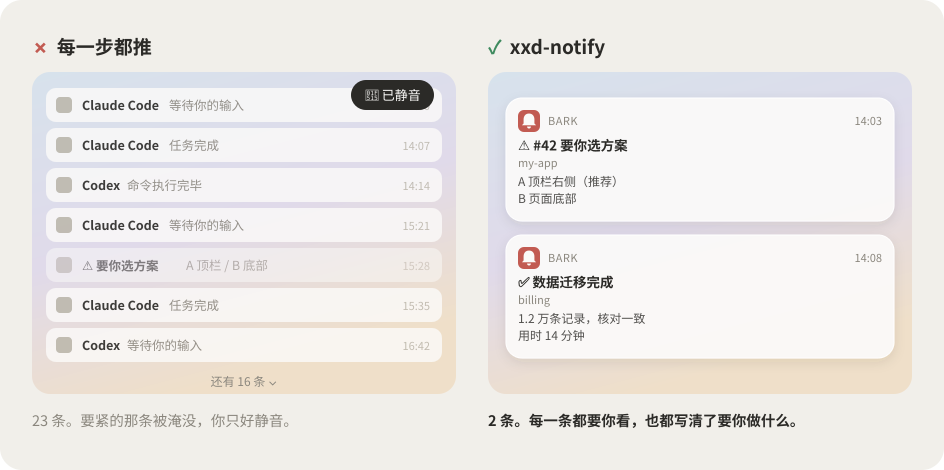

<div align="center">

# xxd-notify

**AI 需要你的时候，手机才响一下。**

一个 Bark 推送地址，终端、脚本、任何 AI 工具都能叫你。<br>附带的 Skill 是我们给 Claude Code、Codex 做的示范：什么时候该叫你、叫你时说清楚要你做什么、网断了也送得到。

<strong>简体中文</strong> · <a href="README.en.md">English</a>


</div>

<p align="center">
  
</p>

<p align="center">
  <a href="#-不装-skill-也能用">不装 Skill 也能用</a> ·
  <a href="#-安装-skill">安装 Skill</a> ·
  <a href="#-它什么时候会响">什么时候响</a> ·
  <a href="#-一条好通知长什么样">好通知</a> ·
  <a href="#-用法">用法</a> ·
  <a href="#-网断了也不丢">断网不丢</a> ·
  <a href="#-配置">配置</a> ·
  <a href="#-常见问题">常见问题</a>
</p>

## 😵 为什么需要它

你让 Claude 跑一个要一个半小时的重构，然后每隔十分钟切回终端看一眼，什么别的事也没干成。终于决定去吃饭，回来发现它在第 3 分钟就停下来问你「导出按钮放 A 还是 B」，等了你 40 分钟。

于是你给它接上通知。结果它每一步都推：等待输入、任务完成、命令执行完毕……一个下午 23 条，你把它静音了。然后真正要你拍板的那一条，也一起被静音了。

<p align="center">
  
</p>

| | 守着终端 | 每一步都推（Stop hook 等） | xxd-notify |
|---|---|---|---|
| 什么时候叫你 | 你自己去看 | AI 一停就响，不管为什么停 | 只在要你拍板、失败、做完时 |
| 通知里写什么 | — | 「等待你的输入」 | 要你决定什么、推荐哪个、去哪看 |
| 专注模式 | — | 一视同仁 | 要你拍板的穿透专注，其余正常或静默 |
| 同一个问题 | — | 每次停都再响 | 只问一遍 |
| 网断了 | — | 这条就没了 | 重试、Mac 本机先弹、网好了补发 |
| 体积 | — | — | 一个 Python 文件，零依赖 |

## 🔑 不装 Skill 也能用

xxd-notify 的底子是 Bark。手机上装好 Bark，你就有了一个推送地址，往这个地址发一个请求，手机就响。浏览器、终端、脚本、定时任务、快捷指令、任何能打开链接的 AI 工具，都能发这个请求。

后面的 Skill 只是我们自己的一种用法：教 Claude Code 和 Codex 什么时候该叫你、通知里写什么。你可以不装它，拿着地址自己组合。

### 拿到推送地址

1. 在 iPhone 上装 [Bark](https://github.com/Finb/Bark)，App Store 搜「Bark」。
2. 打开 App，复制首页的推送地址，长这样：`https://api.day.app/你的Key/`。

> [!WARNING]
> 把这个地址当密码收好。拿到它的人能往你手机推通知，但看不到你的任何东西。泄露了就在 Bark App 里重置 Key。

### 最简单的一条

在浏览器里打开下面这个链接，手机就会响：

```text
https://api.day.app/你的Key/测试跑完了/12个全部通过
```

终端里用 curl 发，可以在问号后面加参数：

```bash
curl "https://api.day.app/你的Key/测试跑完了/12个全部通过?group=AI任务&sound=bell"
```

正文里有空格、换行或特殊符号时，改用 POST 发 JSON，不用自己转码：

```bash
curl -X POST https://api.day.app/push \
  -H 'Content-Type: application/json; charset=utf-8' \
  -d '{"device_key":"你的Key","title":"要你选方案","body":"A 放顶栏（推荐）\nB 放底部","level":"timeSensitive"}'
```

常用的参数在 GET 链接和 JSON 里名字一样：

| 参数 | 作用 |
|---|---|
| `level` | `active` 普通提醒（默认）；`timeSensitive` 专注模式下也会显示；`passive` 只进通知列表，不亮屏；`critical` 静音也响，要先在 Bark 里授权「重要警告」 |
| `sound` | 铃声名，比如 `bell`、`minuet`，Bark 里能试听 |
| `call` | 传 `1` 时铃声连着响 30 秒。要响得更久，就连发几条，Bark 会一条接一条地放 |
| `group` | 通知列表里的分组 |
| `url` | 点开通知时打开的网页 |
| `icon` | 通知图标的图片地址 |

全部参数见 [Bark 的参数说明](https://bark.day.app/#/params)。

### 随手组合

- **长命令跑完叫你**：`npm test && curl -s "https://api.day.app/你的Key/测试通过" || curl -s "https://api.day.app/你的Key/测试挂了"`。
- **定时任务**：cron、launchd、GitHub Actions 的最后一步加一行 curl。在 GitHub Actions 里，把地址存成 Secret，别写进 workflow 文件。
- **快捷指令**：iPhone 或 Mac 的快捷指令里，用「获取 URL 内容」打开推送地址。
- **自己的程序**：任何语言发一个 HTTP 请求就行。Python 只要标准库：

```python
import json, urllib.request
data = json.dumps({"device_key": "你的Key", "title": "备份完成", "body": "共 3.2G"}).encode()
urllib.request.urlopen(urllib.request.Request("https://api.day.app/push", data, {"Content-Type": "application/json"}))
```

### 在别的 AI 工具里用

支持 MCP 的工具，可以直接接 Bark 官方的 MCP 地址，AI 就多了一个「推通知」的工具。在 Claude Code 里是这一行：

```bash
claude mcp add bark --transport http https://api.day.app/mcp/你的Key
```

Cursor、VS Code 等工具在各自的 MCP 设置里填 `https://api.day.app/mcp/你的Key`。

不支持 MCP 的工具，只要它能打开链接或者发网络请求，就能用推送地址。Muse、Grok Bot 这类在网页或 App 里聊天的 AI 也算。

Skill 真正管的就两件事：什么时候叫你，叫你时写什么。这两件事写成几句话，放进任何 AI 工具的规则或自定义指令里一样管用，比如 Cursor 的 Rules、Codex 的 `AGENTS.md`、Claude Code 的 `CLAUDE.md`，或者聊天工具的自定义指令。可以从这一段改起：

```text
需要我拍板（选方案、要花钱、删数据、给真实用户发消息）、任务失败、或者做完的时候，
用 Bark 推一条通知给我：打开 https://api.day.app/<我的Key>/<标题>/<正文>。
标题一句话说结论，正文写清楚要我做什么、推荐哪个、去哪里看。
其余时候不要推，同一件事只推一次。不要把这个地址写进代码、日志或回复里。
```

> [!NOTE]
> 把地址交给云端的 AI 工具，那家公司也就看得到它。介意的话，用完在 Bark App 里重置 Key。

## ⚡ 安装 Skill

先照上面拿到推送地址。Skill 在推送地址上加了两样东西：一份告诉 AI 什么时候该叫你、通知里写什么的规则（[SKILL.md](SKILL.md)），和一个会重试、断网后补发的发送脚本。

### 让 AI 帮你装（推荐）

把下面这段话发给 Claude Code 或 Codex：

```text
帮我安装 xxd-notify：https://github.com/nevertoday/xxd-notify
克隆到 ~/.claude/skills/xxd-notify（如果我也用 Codex，再放一份到 ~/.codex/skills/）。
装好后告诉我在终端运行哪条 setup 命令，我自己粘贴 Bark 地址，不要让我把地址发在对话里。
```

### 一行命令

```bash
npx skills add https://github.com/nevertoday/xxd-notify --skill xxd-notify
# 或者：git clone https://github.com/nevertoday/xxd-notify ~/.claude/skills/xxd-notify
```

然后粘贴 Bark 地址：

```bash
python3 ~/.claude/skills/xxd-notify/scripts/xxd_notify.py setup
```

粘贴的内容不会显示，也不会留在命令历史里。在 Claude Code 里可以直接输入 `! python3 ~/.claude/skills/xxd-notify/scripts/xxd_notify.py setup`。手机收到「🧪 Bark 连接正常」就装好了。

> [!TIP]
> 只要 Python 3.8 及以上，不需要装任何依赖。macOS 和大多数 Linux 都自带 Python。

## 🔔 它什么时候会响

<p align="center">
  
</p>

- **要你拍板**：选方案、要花钱、给真实用户发邮件、删数据、需要登录或续费。用 Bark 的 `timeSensitive` 级别，专注模式下也会亮屏，因为没有你，事情就停在那里。
- **失败了、停下了**：自己修不了，或者额度用完被迫暂停。同样穿透专注模式。
- **做完了、你点名的进度**：正常提醒。进度只在你要求时才发。
- **其余所有时候**：一条都不推。

另外，**你不开口它就不发**。普通对话、普通任务，它不会自作主张去打扰你。

## 📱 一条好通知长什么样

| 一般的通知 | xxd-notify 发的 |
|---|---|
| 任务完成 | **✅ 数据迁移完成**<br>1.2 万条记录，核对一致<br>用时 14 分钟 |
| 请处理 | **⚠️ #42 要你选方案**<br>A 导出按钮放顶栏右侧（推荐）<br>B 放页面底部<br>回终端回复 A/B · *点开通知直接看方案页* |
| 出错了 | **⏹️ 额度用完，任务已停**<br>停在第 37/120 个文件<br>进度已保存，有额度后说「继续」即可 |

- **副标题自动写上项目名**。同时开着五个会话，也知道该回哪一个。
- **第一行就是结论**，在锁屏上扫一眼就够。
- **同一个问题只问一遍**，不会每 10 分钟追着你响。

## 🧭 用法

### 直接跟 AI 说

装好以后不用记命令，在对话里说清楚**什么时候叫你**就行：

- 「把测试全部跑完，做完用 Bark 通知我，失败了也告诉我。」
- 「开 loop 逐个处理 issue。凡是需要我确认的时候（选方案、要花钱、给真实用户发邮件、删数据），先 Bark 我，写清楚要我确认什么、去哪里看。」
- 「这批 500 张图每完成 20% 告诉我一次，遇到异常马上叫我。」
- 「后台那个批处理帮我盯着，卡住了或者磁盘不够就提醒我，跑完也说一声。」
- 「Bark 好像没收到，查一下之前那条发出去没有。」

「需要我确认就叫我」这句只要在会话开头说一次，整个 loop 都有效。Skill 原文在 [SKILL.md](SKILL.md)。

### 不用 AI 也能用

```bash
alias notify="python3 ~/.claude/skills/xxd-notify/scripts/xxd_notify.py"
```

| 命令 | 作用 |
|---|---|
| `notify run --title "跑测试" --tail 3 -- npm test` | 包住任何长命令，结束时按退出码推 ✅ 或 ❌，退出码原样返回 |
| `notify watch --pid 12345 --log logs/latest.log --stall 30` | 盯着后台任务：进程结束推一条；日志 30 分钟不动提醒一次 |
| `notify watch … --disk / --min-free 15` | 磁盘低于 15G 提醒一次 |
| `notify send -s decide -t "要你选域名" -b $'A example.com（推荐）\nB example.ai'` | 自己发一条；`-s` 决定前缀和打扰程度：`decide` `fail` `stop` `done` `progress` |
| `notify history` | 每一条通知的送达情况 |
| `notify flush` | 立刻补发没送到的 |

## 🛟 网断了也不丢

<p align="center">
  
</p>

最需要叫你的时刻，往往网络也正好不稳：代理在切换、Wi-Fi 刚断。所以：

1. **自动重试**：失败后隔 2 秒、5 秒、15 秒各重试一次。
2. **真的发不出去**：先在 Mac 上弹一条本机通知，同时把消息存进待补发；下一条通知送达时顺路补上，并标明原定时间。
3. **不会刷屏**：同样的消息 2 分钟内只发一次，`--once` 能让同一件事一小时内只推一次。
4. **中文不会让它发不出去**：macOS 自带的 bash 3.2 会把紧跟在变量后面的中文弄坏，比如 `$reason（`，以前遇到这种字节整条通知就发不出去，现在照样能发出。

## ⚙️ 配置

```bash
notify config show                  # 查看配置（Key 会被遮住）
notify config set sound birdsong    # 改提示音
notify config set group "AI 任务"    # 改通知中心的分组
notify config set autoSubtitle 0    # 不要自动写项目名
notify test                         # 发一条测试通知
```

| 字段 | 作用 | 默认 |
|---|---|---|
| `sound` | 提示音（Bark 里能试听） | `birdsong` |
| `group` | 通知中心的分组 | `AI 任务` |
| `level` | 没写状态时的打扰程度 | 不填，按状态自动选 |
| `isArchive` | 是否存进 Bark 历史 | `1` |
| `icon` / `url` / `badge` / `copy` / `autoCopy` | 同 Bark 的同名参数 | — |
| `autoSubtitle` | 副标题自动写项目名 | `1` |

<details>
<summary><b>环境变量和配置文件位置</b></summary>
<br>

- 配置文件在 `~/.config/xxd-notify/config.json`，权限为只有你自己能读写；
- `XXD_BARK_CONFIG` 换配置文件的位置；
- `XXD_BARK_ENDPOINT` 临时指定 Bark 地址（适合 CI）；
- `XXD_NOTIFY_SOURCE` 指定副标题；
- 自建的 [bark-server](https://github.com/Finb/bark-server) 也能用，局域网地址允许用 http。

</details>

<details>
<summary><b>在自己的脚本里调用：退出码</b></summary>
<br>

```bash
notify send -t "⚠️ 磁盘快满了" -b "/Volumes/Data 只剩 9G" --once disk-low || true
```

| 退出码 | 含义 |
|---|---|
| `0` | 已送达；或者和刚发过的重复，故意跳过了 |
| `3` | 还没运行 setup |
| `4` | Bark 拒收（多半是 Key 不对） |
| `5` | 重试后仍连不上，消息已存进待补发 |

退出码不为 0 的消息都存进了待补发，所以写 `|| true` 不会丢消息。老的 `scripts/bark_notify.sh --title … --body …` 和 `scripts/bark_config.py` 照样能用。

</details>

## ❓ 常见问题

<details>
<summary><b>和 Claude Code 自带的 Stop hook 通知有什么不一样？</b></summary>
<br>

Stop hook 只要 AI 停下就响，不管它为什么停：做完了、卡住了，还是只是在等你回一句话。xxd-notify 由 AI 判断这次是不是真的需要你，并把要你做的事写在通知里。两者可以一起用。

</details>

<details>
<summary><b>会不会把我的代码发出去？</b></summary>
<br>

只发标题和几行正文，Skill 明确规定不能写 Key、密码、token、私密对话或大段原文。消息会经过 Bark 的服务器（api.day.app）；介意的话可以自建 bark-server。

</details>

<details>
<summary><b>安卓能用吗？</b></summary>
<br>

Bark 只有 iPhone / iPad 版（Apple 芯片的 Mac 也能装），安卓暂时不行。

</details>

<details>
<summary><b>没收到怎么办？</b></summary>
<br>

先跑 `notify history` 看那条是「已送达」还是「待补发」。待补发的消息，在网络或 Key 修好后跑 `notify flush` 就会补发。

</details>

<details>
<summary><b>Key 泄露了怎么办？</b></summary>
<br>

Bark Key 等同于密码。它只存在你本机的配置文件里，不要写进 README、代码、Issue、截图或命令历史。`setup` 用隐藏输入，`config show` 会遮住 Key。泄露了就在 Bark App 里重置。

</details>

## 📦 项目结构

```text
SKILL.md                     给 AI 看的规则：什么时候叫你、怎么写、不能写什么
scripts/xxd_notify.py        发送、重试、待补发、去重、run / watch / setup，只用 Python 标准库
scripts/bark_notify.sh       旧接口，照样能用
tests/                       用本地的假 Bark 服务器测试，不会推到你手机
assets/src/build_assets.py   生成 README 里的动画 SVG（中英两套）
assets/src/social.html       分享封面（GitHub 和 X 上的预览大图）
assets/src/make_gif.py       逐帧渲染出 GIF，再截出 social.png
```

```bash
python3 -m unittest discover -s tests       # 跑测试
python3 assets/src/build_assets.py          # 改了图里的文字后重新生成 SVG
python3 assets/src/make_gif.py              # 需要 Chrome 和 ffmpeg
```

`assets/how-it-works.gif` 是主动画的 GIF 版，用在不能播 SVG 动画的地方，比如推文、小红书、公众号。

## 🙌 致谢

推送靠 [Bark](https://github.com/Finb/Bark)，感谢 Finb 做了这么好用又开源的推送工具。

## 📄 License

[MIT](LICENSE)
