<div align="center">


# xxd-notify

**AI 干活的时候你尽管走开。只有它需要你的时候，iPhone 才会响一下。**

给 Claude Code、Codex 这类 AI 助手用的 Bark 通知 Skill：判断什么时候该叫你，叫你时把事情说清楚，并确保这条真的送到。

简体中文 · [English](README.en.md)

</div>

<p align="center"></p>

## 为什么需要它

你大概遇到过这三种情况：

1. **守着终端。** AI 要跑一个半小时，你每隔十分钟切回来看一眼，什么也干不成。
2. **白等。** 它在第 3 分钟就停下来问你「选 A 还是 B」，你吃完饭回来才看到，40 分钟就这么浪费了。
3. **被吵到静音。** 你给它配了通知，结果每一步都推，手机响到你只好关掉，真正要紧的那条反而淹没在里面。

xxd-notify 把这三件事一起解决：

- **什么时候叫你**：要你出手才叫，平时一声不吭；
- **叫你时说清楚**：要你决定什么、推荐哪个、去哪看；
- **确保送到**：网断了会重试、补发，不会丢。

## 它什么时候会响

<p align="center"></p>

- **要你拍板**：选方案、要花钱、给真实用户发邮件、删数据、需要登录或续费。这类通知用 Bark 的 `timeSensitive` 级别，专注模式下也会亮屏，因为没有你，事情就停在那里。
- **做完了、进度节点**：正常提醒。进度只在你点名要的时候才发。
- **其余所有时候**：一条都不推。

另外，**你不开口它就不发**。普通对话、普通任务，它不会自作主张去打扰你。

## 一条好通知长什么样

| 一般的通知 | xxd-notify 发的 |
|---|---|
| 任务完成 | **✅ 数据迁移完成**<br>1.2 万条记录，核对一致<br>用时 14 分钟 |
| 请处理 | **⚠️ #42 要你选方案**<br>A 导出按钮放顶栏右侧（推荐）<br>B 放页面底部<br>回终端回复 A/B · *点开通知直接看方案页* |
| 出错了 | **⏹️ 额度用完，任务已停**<br>停在第 37/120 个文件<br>进度已保存，有额度后说「继续」即可 |

几个细节：

- **副标题自动写上项目名**。同时开着五个会话，也知道该回哪一个。
- **第一行就是结论**，在锁屏上扫一眼就够。
- **同一个问题只问一遍**，不会每 10 分钟追着你响。

## 怎么用：直接跟 AI 说

装好以后不用记命令，在对话里说清楚**什么时候叫你**就行：

> 把测试全部跑完，做完用 Bark 通知我，失败了也告诉我。

> 开 loop 逐个处理 issue。凡是需要我确认的时候（选方案、要花钱、给真实用户发邮件、删数据），先 Bark 我，写清楚要我确认什么、去哪里看。

> 这批 500 张图每完成 20% 告诉我一次，遇到异常马上叫我。

> 后台那个批处理帮我盯着，卡住了或者磁盘不够就提醒我，跑完也说一声。

> Bark 好像没收到，查一下之前那条发出去没有。

「需要我确认就叫我」这句只要在会话开头说一次，整个 loop 都有效。

## 不用 AI 也能用：三个命令

```bash
alias notify="python3 ~/.claude/skills/xxd-notify/scripts/xxd_notify.py"

# 1. 包住任何长命令：结束时按退出码推 ✅ 或 ❌，退出码原样返回
notify run --title "跑测试" --tail 3 -- npm test

# 2. 盯着后台任务：进程结束推一条；日志 30 分钟不动、磁盘低于 15G 各提醒一次
notify watch --pid 12345 --name "批处理" --log logs/latest.log --stall 30 --disk / --min-free 15

# 3. 自己发一条（-s 决定前缀和打扰程度：decide / fail / stop / done / progress）
notify send -s decide -t "要你选域名" -b $'A example.com（推荐）\nB example.ai' --url "https://…"
```

## 网断了也不丢

<p align="center"></p>

最需要叫你的时刻，往往网络也正好不稳：代理在切换、Wi-Fi 刚断。所以：

- **自动重试**：失败后隔 2 秒、5 秒、15 秒各重试一次；
- **真的发不出去**：先在 Mac 上弹一条本机通知，同时把消息存进待补发；下一条通知送达时顺路补上，并标明原定时间；
- **不会刷屏**：同样的消息 2 分钟内只发一次，`--once` 能让同一件事一小时内只推一次；
- **中文不会让它发不出去**：macOS 自带的 bash 3.2 会把紧跟在变量后面的中文弄坏，比如 `$reason（`，以前遇到这种字节整条通知就发不出去，现在照样能发出；
- **能查**：`notify history` 列出每一条通知的送达情况。

## 3 分钟装好

**1. 手机装 Bark。** 在 App Store 搜「Bark」（[项目主页](https://github.com/Finb/Bark)），打开后复制里面的推送地址。

**2. 装 Skill。**

```bash
npx skills add https://github.com/nevertoday/xxd-notify --skill xxd-notify
# 或者手动：
git clone https://github.com/nevertoday/xxd-notify ~/.claude/skills/xxd-notify
```

Codex 用户把路径换成 `~/.codex/skills/xxd-notify`。

**3. 粘贴地址。**

```bash
python3 ~/.claude/skills/xxd-notify/scripts/xxd_notify.py setup
```

把 Bark 里复制的地址粘进去。粘贴的内容不会显示，也不会留在命令历史里。在 Claude Code 里可以直接输入 `! python3 …/xxd_notify.py setup`。手机收到「🧪 Bark 连接正常」就装好了。

只要 Python 3.8 及以上，不需要装任何依赖。macOS 和大多数 Linux 都自带 Python。

## 配置

```bash
notify config show                  # 查看配置（Key 会被遮住）
notify config set sound birdsong    # 改提示音
notify config set group "AI 任务"    # 改通知中心的分组
notify config set autoSubtitle 0    # 不要自动写项目名
notify test                         # 发一条测试通知
```

| 字段 | 作用 | 默认 |
|---|---|---|
| `sound` | 提示音（Bark 里能试听） | `birdsong` |
| `group` | 通知中心的分组 | `AI 任务` |
| `level` | 没写状态时的打扰程度 | 不填，按状态自动选 |
| `isArchive` | 是否存进 Bark 历史 | `1` |
| `icon` / `url` / `badge` / `copy` / `autoCopy` | 同 Bark 的同名参数 | — |
| `autoSubtitle` | 副标题自动写项目名 | `1` |

- 配置文件在 `~/.config/xxd-notify/config.json`，权限为只有你自己能读写；
- 环境变量 `XXD_BARK_CONFIG` 可以换配置文件的位置；
- `XXD_BARK_ENDPOINT` 可以临时指定 Bark 地址（适合 CI）；
- `XXD_NOTIFY_SOURCE` 可以指定副标题；
- 自建的 [bark-server](https://github.com/Finb/bark-server) 也能用，局域网地址允许用 http。

## 在自己的脚本里调用

```bash
notify send -t "⚠️ 磁盘快满了" -b "/Volumes/Data 只剩 9G" --once disk-low || true
```

| 退出码 | 含义 |
|---|---|
| `0` | 已送达；或者和刚发过的重复，故意跳过了 |
| `3` | 还没运行 setup |
| `4` | Bark 拒收（多半是 Key 不对） |
| `5` | 重试后仍连不上，消息已存进待补发 |

退出码不为 0 的消息都存进了待补发，所以写 `|| true` 不会丢消息。老的 `scripts/bark_notify.sh --title … --body …` 和 `scripts/bark_config.py` 照样能用。

## 常见问题

**和 Claude Code 自带的 Stop hook 通知有什么不一样？**
Stop hook 只要 AI 停下就响，不管它为什么停：做完了、卡住了，还是只是在等你回一句话。xxd-notify 由 AI 判断这次是不是真的需要你，并把要你做的事写在通知里。两者可以一起用。

**会不会把我的代码发出去？**
只发标题和几行正文，Skill 明确规定不能写 Key、密码、token、私密对话或大段原文。消息会经过 Bark 的服务器（api.day.app）；介意的话可以自建 bark-server。

**安卓能用吗？**
Bark 只有 iPhone / iPad 版（Apple 芯片的 Mac 也能装），安卓暂时不行。

**没收到怎么办？**
先跑 `notify history` 看那条是「已送达」还是「待补发」。待补发的消息，在网络或 Key 修好后跑 `notify flush` 就会补发。

## 开发

```bash
python3 -m unittest discover -s tests     # 测试用本地的假 Bark 服务器，不会推到你手机
python3 assets/src/build_assets.py        # 重新生成 README 里的动画 SVG（中英两套）
```

`assets/how-it-works.gif` 是主动画的 GIF 版，用在不能播 SVG 动画的地方，比如推文、小红书、公众号。

## 安全

Bark Key 等同于密码。它只存在你本机的配置文件里，不要写进 README、代码、Issue、截图或命令历史。`setup` 用隐藏输入，`config show` 会遮住 Key。如果 Key 泄露了，在 Bark App 里重置即可。

## License

MIT
